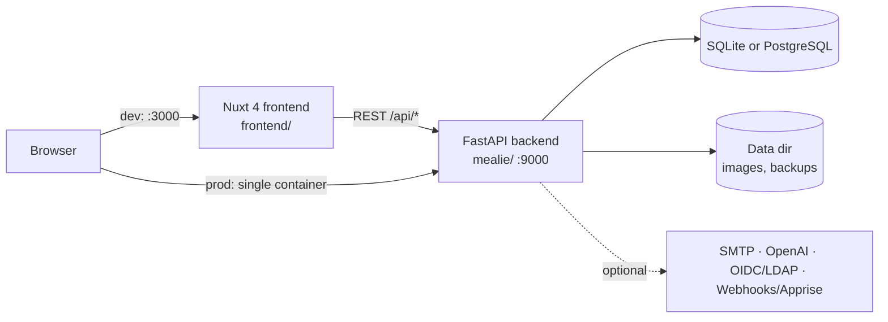
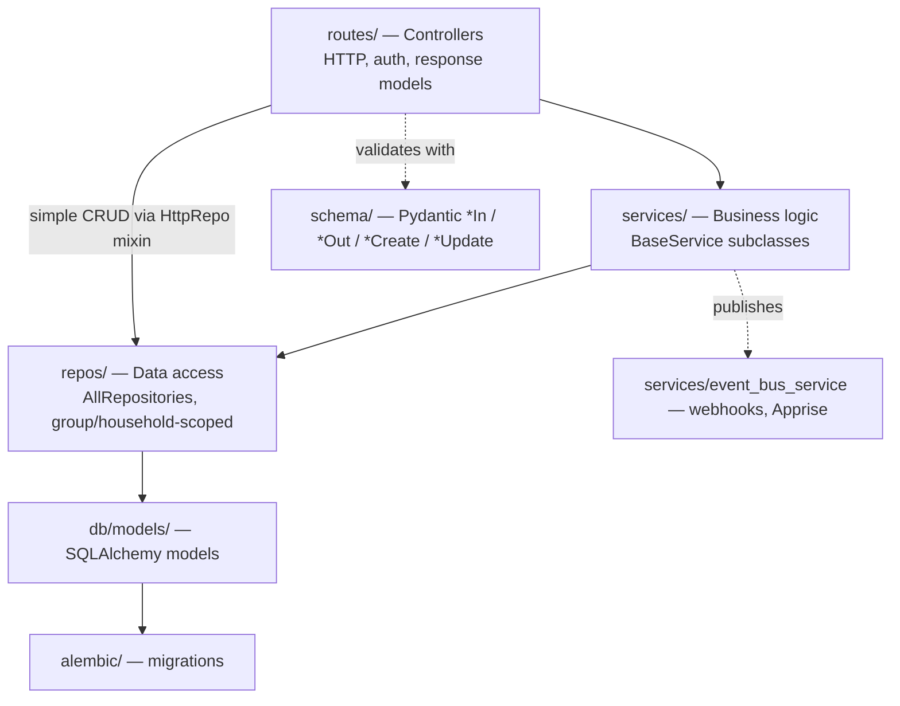
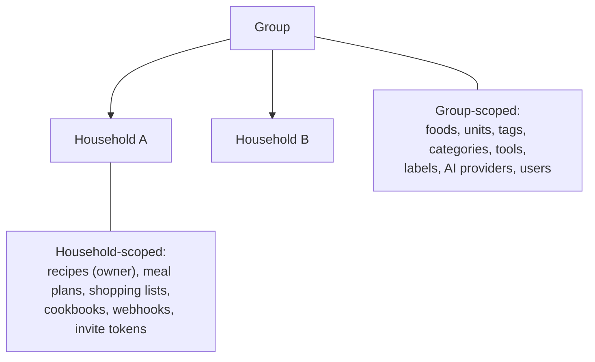

# Mealie Architecture

A map of how Mealie fits together. Start here before you change anything. Every path below exists in the repo, so open them as you read.

> Related: [onboarding.md](onboarding.md) · [testing.md](testing.md) · [glossary.md](glossary.md) · [adr/](adr/)

## 1. System context

| Mode | Frontend | Backend |
|------|----------|---------|
| Development | `task ui`: Nuxt dev server on port 3000 | `task py`: uvicorn on port 9000 |
| Production | Built statically, then served by FastAPI from `mealie/routes/spa/` | The same process serves both the API and the SPA |

The app entry point is `mealie/app.py`. Its `lifespan_fn` initialises the DB (`mealie/db/init_db.py`, which runs the Alembic migrations and seeds data) and starts the scheduler. It also mounts:
- the `/api` router from `mealie/routes/__init__.py`
- the media routes
- the SPA routes

## 2. Backend layers

| Layer | Where | Key files |
|-------|-------|-----------|
| Routing | `mealie/routes/<domain>/` | `routes/__init__.py` (mounts each domain under `/api`), `routes/_base/routers.py` (`UserAPIRouter`, `AdminAPIRouter`, `MealieCrudRoute`) |
| Controllers | the same folders | `routes/_base/base_controllers.py` (`BasePublicController`, `BaseUserController`, `BaseCrudController`, `BaseAdminController`), `routes/_base/controller.py` (the `@controller` class-based-view decorator), `routes/_base/mixins.py` (`HttpRepo`) |
| Services | `mealie/services/<domain>/` | `services/_base_service/__init__.py`, e.g. `services/recipe/recipe_service.py` |
| Repositories | `mealie/repos/` | `repository_factory.py` (`AllRepositories`, one property per repo), `repository_generic.py` (`RepositoryGeneric`, `GroupRepositoryGeneric`, `HouseholdRepositoryGeneric`), `all_repositories.py` (`get_repositories`) |
| Models | `mealie/db/models/{group,household,recipe,users,server}/` | `_model_base.py` |
| Schemas | `mealie/schema/<domain>/` | `_mealie/` (the `MealieModel` base) |
| Cross-cutting | `mealie/core/` | `config.py` (`get_app_settings`, `get_app_dirs`), `settings/`, `security/` (tokens, hashing, auth providers), `dependencies/dependencies.py` (`get_current_user`, …) |
| Shared packages | `mealie/pkgs/` | `cache`, `i18n`, `img`, `safehttp` (SSRF-safe HTTP client), `stats` |
| Sessions | `mealie/db/db_setup.py` | `generate_session` (FastAPI dependency), `session_context` (scripts and jobs) |

### Worked trace: `GET /api/recipes/{slug}`

Follow one request through the stack:

1. **Frontend page.** `frontend/app/pages/g/[groupSlug]/r/[slug]/index.vue` uses `composables/recipes/use-recipe.ts`. That calls `useUserApi().recipes.getOne(slug)`.
2. **API client.** `frontend/app/lib/api/user/recipes/recipe.ts`. `RecipeAPI extends BaseCRUDAPI`, and its `itemRoute` builds `/api/recipes/{slug}`. `getOne` lives in `lib/api/base/base-clients.ts`.
3. **Router.** `mealie/routes/recipe/recipe_crud_routes.py`: `router = UserAPIRouter(prefix="/recipes", route_class=MealieCrudRoute)`. `UserAPIRouter` requires an authenticated user.
4. **Controller.** `RecipeController(BaseRecipeController)` is decorated with `@controller(router)`, and `get_one(slug)` calls `self.service.get_one(slug)`. `BaseRecipeController` lives in `routes/recipe/_base.py` and builds `RecipeService(self.repos, self.user, self.household, ...)`.
5. **Scoping.** `self.repos` (see `BaseUserController` in `base_controllers.py`) is `AllRepositories(session, group_id=user.group_id, household_id=user.household_id)`.
6. **Service.** `RecipeService.get_one` in `services/recipe/recipe_service.py` delegates to `repos.recipes`, which handles the lookup and permission checks.
7. **Repository.** `repos.recipes` is a `RepositoryRecipes` (`repos/repository_recipes.py`). `RepositoryGeneric._filter_builder` adds `group_id` / `household_id` to every query, so a slug from another group returns a 404.
8. **Response.** The result is a Pydantic `Recipe` (`schema/recipe/recipe.py`). `MealieCrudRoute` adds a `last-modified` header.

To trace any other feature the same way, use the `/trace <feature>` Claude command.

## 3. Multi-tenancy

- Every user belongs to exactly **one group and one household**.
- `AllRepositories` is constructed with `group_id` / `household_id`, and repositories filter on them automatically:
  - `GroupRepositoryGeneric` requires a group.
  - `HouseholdRepositoryGeneric` requires both.
  - Passing `NOT_SET` raises an error, by design.
- Recipes belong to a household but can be read across the group. See `group_recipes` in `routes/recipe/_base.py`, which sets `household_id=None`.
- `BaseAdminController` uses **unscoped** repos (`group_id=None, household_id=None`). Only admin routes may do this.
- `tests/multitenant_tests/` proves that the isolation holds. Add a case there for any new scoped resource.
- Decision record: [adr/0003-group-household-multitenancy.md](adr/0003-group-household-multitenancy.md).

## 4. Code generation

The Pydantic schemas are the source of truth. `task dev:generate` runs `dev/code-generation/main.py`:

| Generator | Output |
|-----------|--------|
| `gen_ts_types.py` | `frontend/app/lib/api/types/*.ts` |
| `gen_py_schema_exports.py` | `mealie/schema/*/__init__.py` |
| `gen_py_pytest_routes.py`, `gen_py_pytest_data_paths.py` | URL and data-path helpers under `tests/utils/` |
| `gen_ts_locales.py`, `gen_ts_unit_systems.py` | Frontend locale and unit-system constants |

Never edit the generated outputs by hand. `.claude/hooks/block-generated-edits.js` blocks agents from doing it. Decision record: [adr/0002-generated-frontend-types.md](adr/0002-generated-frontend-types.md).

## 5. Background work and events

- **Scheduler** (`mealie/services/scheduler/`): `SchedulerService` and `SchedulerRegistry` run periodic jobs from `scheduler/tasks/`, for example:
  - posting webhooks
  - purging expired share tokens, exports and password resets
  - deleting old checked shopping-list items
  - creating timeline events
- **Event bus** (`mealie/services/event_bus_service/`): controllers and services call `publish_event(...)`. `BaseCrudController` provides it. `EventBusService.dispatch` fans events out to `AppriseEventListener` and `WebhookEventListener`. Event types are in `event_types.py`.

## 6. Other notable backend services

| Area | Location |
|------|----------|
| Recipe scraping from URLs | `services/scraper/` |
| Ingredient parsing (NLP, brute-force and OpenAI parsers) | `services/parser_services/`, plus the guide at `docs/docs/contributors/guides/ingredient-parser.md` |
| Importers from other apps | `services/migrations/` |
| Backups and restore | `services/backups_v2/` |
| Exports | `services/exporter/` |
| OpenAI integration | `services/openai/` |
| Seed data (foods, units, labels) | `services/seeder/`, `repos/seed/` |
| Query filter language (`queryFilter=` param) | `services/query_filter/` |
| Email | `services/email/` |

## 7. Frontend

| Concern | Location |
|---------|----------|
| Pages and routing (file-based) | `frontend/app/pages/`. Group-scoped pages are under `g/[groupSlug]/` (recipes are at `r/[slug]`). Also `household/`, `admin/`, `user/` |
| Components | `frontend/app/components/{Domain,global,Layout}`. Naming rules are in `components/README.md` |
| API clients | `frontend/app/lib/api/{user,admin,public}/`. They're aggregated in `client-user.ts` / `client-admin.ts` / `client-public.ts` and exposed through `composables/api/api-client.ts` (`useUserApi`, `useAdminApi`, `usePublicApi`) |
| Generated types | `frontend/app/lib/api/types/` (do not edit) |
| State and shared logic | `frontend/app/composables/`. No Vuex/Pinia. Auth is in `use-mealie-auth.ts` / `use-auth-backend.ts` |
| i18n | `frontend/app/lang/messages/en-US.json` is the only file you edit. Crowdin syncs the other locales (`crowdin.yml`) |
| Tests | Vitest, `frontend/vitest.config.js`, `__tests__` folders next to the code |

## 8. Where do I find…

| I want to… | Look in |
|------------|---------|
| Add an API endpoint | `/add-endpoint` command; `mealie/routes/<domain>/` |
| Change a DB table | `mealie/db/models/`, then `task py:migrate -- "msg"`; see `docs/docs/contributors/developers-guide/database-changes.md` |
| Change an API payload | `mealie/schema/`, then `task dev:generate` |
| Change auth/login | `mealie/core/security/`, `mealie/routes/auth/`, `frontend/app/composables/use-mealie-auth.ts` |
| Add an app setting or env var | `mealie/core/settings/settings.py` |
| Add a periodic job | `mealie/services/scheduler/tasks/` |
| Change CI | `.github/workflows/` (`test-backend.yml`, `test-frontend.yml`, `e2e.yml`, …) |
| Build or run Docker | `docker/`, `task docker:prod` |
